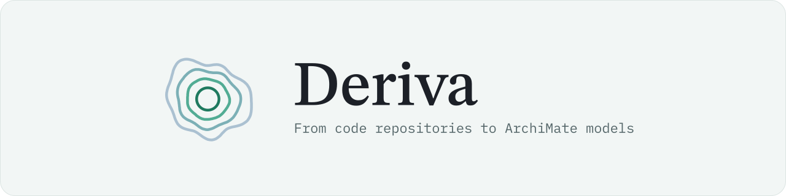
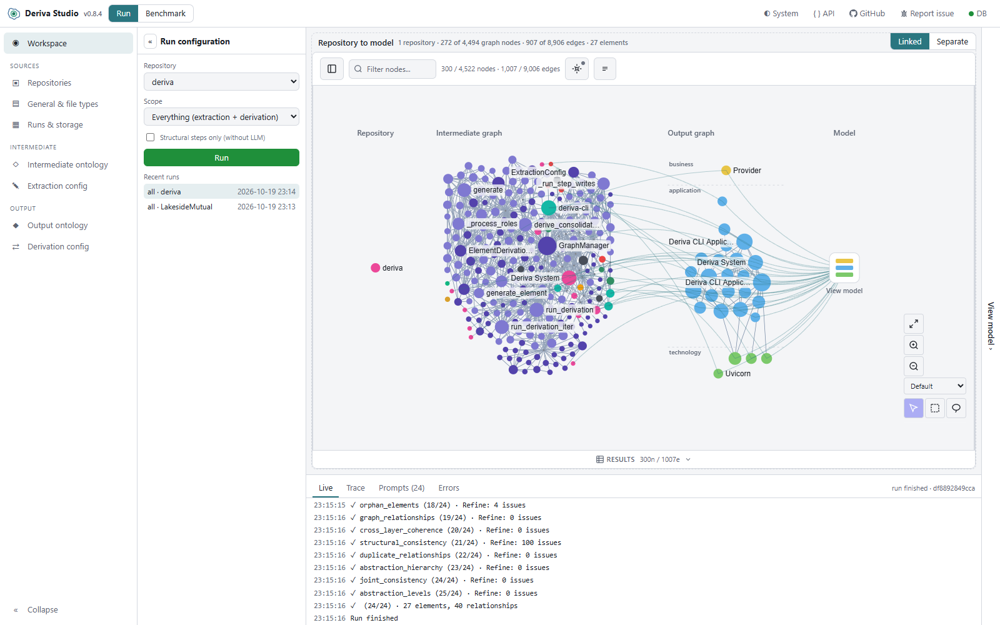

[](#)
[](https://github.com/StevenBtw/Deriva/actions/workflows/ci.yml)
[](https://www.python.org/downloads/)
[](https://github.com/StevenBtw/grafeo)
[](LICENSE) 

<picture>
  <source media="(prefers-color-scheme: dark)" srcset="assets/brand/deriva-banner-dark.svg">
  
</picture>

Deriva reads a software repository, builds a graph of what is in it, and derives an [ArchiMate](https://www.opengroup.org/archimate-forum) enterprise architecture model you can open in tools like [Archi](https://www.archimatetool.com/).

<picture>
  <source media="(prefers-color-scheme: dark)" srcset="assets/studio-dark.png">
  
</picture>

## How It Works

Deriva brings determinism to AI-assisted architecture model derivation. From repository to intermediate graph to output graph to the final ArchiMate model. Parsing and graph algorithms find the structure; an LLM reads what needs reading. Every prompt is versioned configuration you can open and change.

1. **Repository** (clone): the code as it is, a Git repository cloned locally. Deriva classifies every file by type, from source and config to docs, tests and build files.
2. **Intermediate graph** (extract): parsing (tree-sitter for most languages) turns the code into a graph of directories, files, types, methods, dependencies, technologies and business concepts. Graph metrics (PageRank, Louvain communities, k-core) then rank what matters.
3. **Output graph** (derive): graph structure picks the candidates; an LLM classifies and names them within ArchiMate's rules, then refine steps tidy the result. The studio shows both graphs side by side.
4. **ArchiMate model** (export): the output graph exports in the Open Group ArchiMate exchange format, ready to open in Archi.

## Install

Deriva runs on your own machine: Deriva Studio in your browser, the pipeline and its embedded databases locally. Nothing is sent anywhere except the prompts to the LLM you choose.

### Requirements

- **uv**, the Python package manager (below). It downloads Python 3.14 for you.
- **Git**, to clone the repositories you analyse.
- **An LLM**: an API key for Azure OpenAI, OpenAI, Anthropic or Mistral, or a local model in Ollama or LM Studio.

### 1. Install uv

Windows (PowerShell):

```bash
powershell -ExecutionPolicy ByPass -c "irm https://astral.sh/uv/install.ps1 | iex"
```

macOS and Linux:

```bash
curl -LsSf https://astral.sh/uv/install.sh | sh
```

### 2. Install Deriva Studio

```bash
uv tool install --python 3.14 deriva-studio
deriva
```

`deriva` starts the studio and opens it in your browser at http://127.0.0.1:8765. It listens on this machine only; `--port` picks another port, `--no-browser` leaves the browser closed, and the API documentation is at `/docs`.

To try Deriva without installing it:

```bash
uvx --python 3.14 deriva-studio
```

`--python 3.14` matters: Deriva needs Python 3.14, and without it uv may pick an older Python and refuse the install.

### 3. Add a model

On its first start the studio shows a banner until an LLM model is configured. Open **General**, add a model under **Models** and save; [Set Up an LLM](#set-up-an-llm) explains the fields. Structural steps run without a model, so **Structural steps only (without LLM)** in the Workspace gives a first look right away.

### Which package

| Package | Gives you | Commands |
|---------|-----------|----------|
| `deriva-studio` | the studio and the command line | `deriva`, `deriva-studio`, `deriva-cli` |
| `deriva-cli` | the command line only, for scripts, CI and servers | `deriva-cli` |
| `deriva-dev` | everything, plus benchmarking | `deriva`, `deriva-dev`, `deriva-cli` |

All three release together with the same version number.

### Where Deriva keeps its files

An installed Deriva keeps everything in one folder, `~/.deriva` (on Windows `%USERPROFILE%\.deriva`):

| In the home folder | Holds |
|--------------------|-------|
| `.env` | your settings and model configs; the studio writes it when you save the first model |
| `sql.db` | the step configurations with their versions, file types, name patterns and settings; created from the defaults on first start |
| `workspace/` | cloned repositories, the graphs, caches, runs, benchmark sessions and exports |

The environment variable `DERIVA_HOME` moves this folder, for example to keep projects apart or to try something in a sandbox. `deriva-cli status` shows which home folder is in use. Relative paths in `.env` are read from the home folder, so Deriva finds the same files from any working directory.

### Upgrade and uninstall

```bash
uv tool upgrade deriva-studio
uv tool uninstall deriva-studio
```

An upgrade keeps your work: the configuration database only gets the schema changes a new version needs, and your own step versions stay as they are. Uninstalling leaves the home folder in place; delete `~/.deriva` to remove your data too.

The packages share the `deriva` and `deriva-cli` commands, so install one of them. To switch, for example to get benchmarking, uninstall the other first; your home folder stays:

```bash
uv tool uninstall deriva-studio
uv tool install --python 3.14 deriva-dev
```

### Reproduce a release exactly

Every GitHub release has a `constraints.txt` with the exact version of every dependency. Download it from the release's assets into the current folder, then install against it:

```bash
uv tool install --python 3.14 deriva-dev==0.8.0 -c constraints.txt
```

### Next to other Python packages

Deriva's Python package is named `deriva`, like the client of ISI's DERIVA platform (`deriva-py`, on PyPI as `deriva`). The two cannot share one Python environment. Install Deriva as a tool, as above, or in a virtual environment of its own.

### From source

For development, or to follow the latest changes:

```bash
git clone https://github.com/StevenBtw/Deriva.git
cd Deriva
uv sync
cd studio && npm install && npm run build && cd ..
uv run deriva
```

`uv sync` installs all three packages from the checkout, with the development tools. The checkout is its own home folder: `.env` and `workspace/` sit in the repository root, and the configuration database in `deriva/adapters/database/sql.db`. Building the front end needs Node 22; build again after you pull changes to `studio/`. [CONTRIBUTING.md](CONTRIBUTING.md) has the details.

---

## Set Up an LLM

Each model gets a block of `LLM_{NAME}_*` settings in `.env` in your home folder (the studio's **General** page writes them for you), and `LLM_DEFAULT_MODEL` picks the one Deriva uses. The default model is the name in lowercase with hyphens: `LLM_MISTRAL_SMALL_*` becomes `mistral-small`.

```bash
# .env: a cloud model
LLM_DEFAULT_MODEL=mistral-small
LLM_MISTRAL_SMALL_PROVIDER=mistral
LLM_MISTRAL_SMALL_MODEL=mistral-small-2603
LLM_MISTRAL_SMALL_KEY=your-mistral-api-key
```

Name a dated model version (`mistral-small-2603`) rather than a `-latest` alias, so a run says which model answered; each LLM call also records the model the provider reports. Some models need more settings:

```bash
# .env: models without a temperature, or with reasoning to switch off
LLM_ANTHROPIC_HAIKU_PROVIDER=anthropic
LLM_ANTHROPIC_HAIKU_MODEL=claude-haiku-5-5
LLM_ANTHROPIC_HAIKU_SAMPLING=false    # takes no temperature: Deriva leaves it out
LLM_ANTHROPIC_HAIKU_REASONING=none    # thinking off
LLM_OPENAI_LUNA_PROVIDER=openai
LLM_OPENAI_LUNA_MODEL=gpt-6-luna
LLM_OPENAI_LUNA_REASONING=none        # reasoning off, so the temperature applies
LLM_OPENAI_LUNA_TEMPERATURE=0         # this model's own temperature, over LLM_TEMPERATURE
```

`REASONING` is a level (`none`, `low`, `medium`, `high`) for OpenAI, Azure and Anthropic models. Without `SAMPLING`, an Anthropic model that refuses a temperature (such as Claude Haiku 5.5) gets none, and every other model takes one. A model with `SAMPLING=false` runs at its provider's default sampling, so its answers can vary more than those of a model at temperature 0. `TEMPERATURE` (0 to 2) sets one model's temperature; models without it use `LLM_TEMPERATURE`. Every LLM call records the temperature it sent (none with `SAMPLING=false`); top_p and seed are never sent, so the provider's defaults apply. `deriva-cli config model set <name> --provider <provider> --model <model id> --sampling false --reasoning none --temperature 0` writes these settings.

A local model needs no key:

```bash
# .env: a local model in Ollama
LLM_DEFAULT_MODEL=ollama-devstral
LLM_OLLAMA_DEVSTRAL_PROVIDER=ollama
LLM_OLLAMA_DEVSTRAL_MODEL=devstral-small-2
LLM_OLLAMA_DEVSTRAL_URL=http://localhost:11434/api/chat
LLM_OLLAMA_DEVSTRAL_CONTEXT=8192      # the server's context window, in tokens
```

Ollama gives each model a 4096-token window unless you start it with a larger one (`OLLAMA_CONTEXT_LENGTH=8192 ollama serve`), and it cuts a longer prompt without an error. Deriva cannot set the window through Ollama's OpenAI-compatible API, so start the server with the size you need and set `CONTEXT` to the same number (`deriva-cli config model set <name> ... --context 8192`). A call that fills the window is then logged as a warning. Very small local models (about 3B parameters) can fail the classification steps with `Exceeded maximum output retries`; use a larger model when they do.

| Provider | For |
|----------|-----|
| `azure` | Azure OpenAI |
| `openai` | OpenAI |
| `anthropic` | Anthropic |
| `mistral` | Mistral |
| `ollama` | Ollama, local |
| `lmstudio` | LM Studio, local |

To check a model config, press **Test** next to it on the studio's **General** page, or run `deriva-cli config model test <name>`: it makes one small call and says whether the key, the model id and the URL work, or what to fix.

Rate limits, retries and the response cache have defaults; `.env.example` lists every setting.

---

## Using Deriva

### Analyse your first repository

1. Open **Repositories** in the studio's menu and choose **+ Clone repository**. Enter the Git URL; a name and a branch are optional.
2. Open the **Workspace**, pick the repository and a scope, and press **Run**. **Structural steps only (without LLM)** gives a first look without any LLM calls.
3. Follow the run in the tabs at the bottom: **Live**, **Trace**, **Prompts** and **Errors**. The intermediate graph and the output graph fill in side by side.
4. **View model**, on the right edge, opens the output graph as an ArchiMate diagram; click an element for its details.

### Export to Archi

Deriva writes the model in the Open Group ArchiMate exchange format. From the studio: open **View model** and press **Export XML**; the browser saves it as `<repository>-<yyyymmdd-hhmmss>.xml`, and a copy under the same name stays in `workspace/output` on the machine that runs the studio. Or from the command line:

```bash
uv run deriva-cli export -o workspace/output/model.xml --repo my-repo
```

In Archi, choose **File**, **Import**, **Open Exchange XML Model** and pick the file.

### Change a prompt

1. Open **Extraction config** or **Derivation config** in the menu.
2. Pick a step and edit its instruction or example. Every LLM step follows the same pattern: input, instruction, example.
3. Press **Save as new version**. Earlier versions stay in the history (**Use this version** there brings one back as a new version), and each step can be switched on or off.

Run the repository again to see the effect.

---

## Configuration

### Environment Variables (.env)

All configuration lives in `.env` in your [home folder](#where-deriva-keeps-its-files); a variable set in the environment wins over the file. Key settings:

```bash
# Graph database (grafeo embedded)
GRAFEO_DB_DIR=workspace/graphs  # Default: one <repo>.grafeo database per repository in the home folder; empty = in-memory

# LLM Provider (mistral, openai, azure, anthropic, ollama, lmstudio)
LLM_MISTRAL_SMALL_PROVIDER=mistral
LLM_MISTRAL_SMALL_MODEL=mistral-small-2603
LLM_MISTRAL_SMALL_KEY=your-mistral-api-key

# Namespaces
GRAPH_NAMESPACE=Graph
ARCHIMATE_NAMESPACE=Model

# NLP translation models for business concepts (default shown)
DERIVA_NLP_MODELS_DIR=workspace/cache/nlp
```

See `.env.example` for all available options.

### Rate Limiting

The LLM adapter includes built-in rate limiting to prevent API throttling:

```bash
# Requests per minute (0 = use provider default: 60 RPM for cloud, unlimited for local)
LLM_RATE_LIMIT_RPM=0

# Minimum delay between requests in seconds
LLM_RATE_LIMIT_DELAY=0.0

# Max retries on rate limit (429) errors
LLM_RATE_LIMIT_RETRIES=3

# Adaptive throttling (reduces RPM when hitting rate limits)
LLM_THROTTLE_ENABLED=true
LLM_THROTTLE_MIN_FACTOR=0.25    # Minimum 25% of configured RPM
LLM_THROTTLE_RECOVERY_TIME=60   # Seconds before trying to increase RPM

# Circuit breaker (stops requests when provider is failing)
LLM_CIRCUIT_BREAKER_ENABLED=true
LLM_CIRCUIT_FAILURE_THRESHOLD=5   # Consecutive failures to open circuit
LLM_CIRCUIT_RECOVERY_TIME=30      # Seconds before testing recovery
```

Default rate limits by provider:

| Provider | Default RPM |
|----------|-------------|
| OpenAI | 30 |
| Anthropic | 30 |
| Mistral | 60 |
| Ollama | Unlimited |
| LM Studio | Unlimited |

The rate limiter automatically:

- Throttles requests to stay within limits
- Applies exponential backoff on rate limit errors (HTTP 429)
- Respects Retry-After headers from providers
- Adaptively reduces RPM when hitting rate limits (recovers over time)
- Opens circuit breaker after consecutive failures to prevent cascading errors

### Managing File Types

If you encounter **undefined extensions** during extraction:

**Via the studio:**

1. Open **General & file types** in the menu
2. Add them to the registry:
   - Extension (e.g., `.tsx`, `Dockerfile`)
   - Type (source, config, docs, test, build, asset, data, exclude)
   - Subtype (e.g., `typescript`, `docker`)

**Via CLI:**

```bash
# List all registered file types
uv run deriva-cli config filetype list

# Add a new file type
uv run deriva-cli config filetype add ".tsx" source typescript

# Delete a file type
uv run deriva-cli config filetype delete ".tsx"

# Show file type statistics by category
uv run deriva-cli config filetype stats
```

> **Note:** Files with unrecognized extensions are automatically classified as `file_type="unknown"` with their extension as the subtype. This ensures all files get proper classification even without explicit registry entries.

**Excluded directories:** dependency and tool directories are skipped by every repository walk (no Directory or File nodes, no LLM calls), matched as whole path segments. The list is the `excluded_directories` system setting (JSON list); by default `.git`, `__pycache__`, `node_modules`, `bower_components`, `vendor`, `.venv`, `venv` and `site-packages`. Changing it triggers re-extraction.

```bash
uv run deriva-cli config setting show excluded_directories
uv run deriva-cli config setting set excluded_directories '[".git", "node_modules", "third_party"]'
```

**Derivation name patterns:** some derivation steps use include and exclude patterns on the names of their code candidates; business concepts are already classified and skip them. Most of these steps reject a name that contains an exclude pattern and keep one that contains an include pattern, and a name that matches neither follows the step's default (rejected by most steps, kept by BusinessFunction, ApplicationInterface, SystemSoftware and TechnologyService). BusinessObject (type definitions) and BusinessEvent (methods) use the patterns to rank candidates instead, and fill their remaining slots with names that did not match. A step that uses the default candidate filter (ApplicationComponent, ApplicationInterface, BusinessFunction, DataObject, Device, Node, SystemSoftware, TechnologyService) can limit the patterns to candidates with given graph labels with its `pattern_labels` param, and set a k-core threshold with `graph_filter`. Patterns are stored per step, type and category.

```bash
uv run deriva-cli config pattern list Node
uv run deriva-cli config pattern add Node include deployment helm
uv run deriva-cli config pattern delete Node include --category deployment helm   # a category left empty is deactivated
```

**Full derivation runs start from an empty model:** a derivation run skips every candidate the model already has, so a run on top of an earlier model derives less than a run from scratch. A full run (`run derivation` or `run all` without `--phase` or `--only-step`, and the studio's run scopes) therefore clears the model first, as benchmarks do. Runs of one phase or one step keep the model. The `derivation_clear_model` system setting (default `true`) switches this off; with benchmarking installed, the studio shows it as a switch in **General**.

```bash
uv run deriva-cli config setting set derivation_clear_model false
```

### Updating Configurations (Versioning)

Deriva uses a **versioning system** for configurations. When you update a config, a new version is created while preserving previous versions for rollback.

**Correct ways to update configs:**

1. **Via the studio**: open **Extraction config** or **Derivation config**, edit the instruction or example, and click **"Save as new version"**
2. **Via CLI**: Use the `config update` command

```bash
# Update extraction config instruction
uv run deriva-cli config update extraction BusinessConcept \
  -i "New instruction text..."

# Update extraction config with batch size for multi-file LLM calls
uv run deriva-cli config update extraction BusinessConcept \
  --batch-size 5

# Update derivation config from file
uv run deriva-cli config update derivation ApplicationComponent \
  --instruction-file prompts/app_component.txt

# View all versions
uv run deriva-cli config versions

# Start a release from version 1 (removes the version history; keep a backup)
uv run deriva-cli config reset-versions --yes
```

**Do NOT use JSON import/export for config updates.** The `db_tool import` command is only for backup restoration or migration - it overwrites version history. See [docs/benchmarks.md](docs/benchmarks.md) for the optimization workflow.

### Customizing Extraction Prompts

For LLM-assisted extraction steps:

1. Open **Extraction config** in the studio's menu and pick a step (e.g., BusinessConcept)
2. Edit its input sources, instruction, example or params
3. Press **Save as new version**; earlier versions stay in the history

All prompts follow the **Input + Instruction + Example** pattern.

---

## Studio

The studio is Deriva's local web UI (`uv run deriva`): a FastAPI backend over `PipelineSession` and a React front end.

| Area | Purpose |
|------|---------|
| **Workspace** | Run the pipeline (repository, scope, structural steps only), follow it live, see the repository, the intermediate graph and the output graph linked live in one canvas (or separately), open the ArchiMate model |
| **Repositories** | Clone, update (`git pull`), inspect and delete repositories; each repository's graph database with its counts, size and last runs, and Clear model or Clear graph and model |
| **General & file types** | System settings (excluded directories) and the file type registry |
| **Runs & storage** | Every run the studio kept (filter, delete, keep the latest N) and what the workspace keeps on disk: LLM cache, exported models, graph databases (one whose repository is gone can go), benchmark sessions |
| **Intermediate / Output ontology** | Every node type and element type with its count and the step that produces it, the edge and relationship types, and the matrix of what connects to what |
| **Extraction / Derivation config** | Step tables with versions; edit instructions and examples, save as a new version, switch steps on or off |

The graphs use [anywidget-graph](https://github.com/GrafeoDB/anywidget-graph) (its query bar runs read-only Cypher against the embedded databases) and the model uses [anywidget-archimate](https://github.com/StevenBtw/anywidget-archimate). While a CLI run holds the databases, the studio says so and shows what it can.

For front-end development, run `uv run deriva` and, in `studio/`, `npm run dev` (Vite forwards the API to port 8765, or to `DERIVA_STUDIO_API` for a studio on another port); `npm test`, `npm run lint` and `npm run typecheck` check it.

---

## Data Storage

- **Grafeo** (embedded graph database):
  - **Graph namespace**: the intermediate graph (directories, files, types, methods, dependencies, technologies, business concepts)
  - **Model namespace**: the output graph (ArchiMate elements and relationships)
- **DuckDB** (`sql.db` in your home folder; in a source checkout `deriva/adapters/database/sql.db`): step configurations with their versions, file types, name patterns and settings; created on first use from the shipped defaults

### Managing Data

Each repository has its own graph database (`workspace/graphs/<repository>.grafeo`) with its graph and its model.

- **Repositories page**: **Clear model** (the graph stays; the next derivation builds the model again), **Clear graph and model** (the next extraction starts from nothing), **Update clone**, and **Delete** with or without its graph and model
- **Runs & storage page**: delete runs (one, the interrupted ones, or all past the latest N), clear the LLM cache (the next runs call the LLM again, and answers can differ from the cached ones), delete exported models, and delete a graph database whose repository is gone
- **CLI**: `deriva-cli clear graph|model --repo <name>`, `deriva-cli repo update <name>`, `deriva-cli repo delete <name> --with-data`, `deriva-cli repo register [name]` (records a git folder in the workspace that has no record)

These actions wait for a run to end.

### Checking an Extraction

The Repositories page's **Coverage** section (and `deriva-cli coverage --repo <name>`, with `--json` for every file) compares a repository's checkout with its graph: how many files reached the graph, per extension which step reads them for types and methods and how many gave some, and the files that could not be read with the reason. An extraction is **incomplete** when files did not reach the graph, could not be read, or when not one source file gave a type or method; source files no step reads (shell scripts, say) are listed as notes. The run's **Errors** tab lists the errors of every step, also the files a completed step could not read, with a download of the whole list.

The model panel's **Quality** pill (and `deriva-cli quality --repo <name>`, with `--json`) judges a derived model from its structure. A model is **weak** when more than a quarter of its elements have no relationship, when nearly all relationships are Composition or Aggregation, when the Application or Technology layer is empty, or when elements have no file, type or method behind their sources (a component derived from a folder that holds no source file). The thresholds are the settings `quality_max_orphan_share` and `quality_max_structural_share` (`deriva-cli config setting set`). The verdict is a report; it changes nothing in the model.

---

## Querying the Graph

In the Workspace's Separate view, each graph panel has a query bar that runs read-only Cypher against the embedded Grafeo database. A few to start with:

```cypher
// All repositories
MATCH (r:Graph:Repository) RETURN r.repoName, r.url

// The files of one repository, with their type
MATCH (repo:Graph:Repository)-[:`Graph:CONTAINS`*]->(f:Graph:File)
WHERE repo.repoName = 'my-repo'
RETURN f.filePath, f.fileType

// Type definitions
MATCH (td:Graph:TypeDefinition) RETURN td.typeName, td.category, td.filePath
```

---

## CLI (Headless Mode)

`uv run deriva` starts the studio; `uv run deriva-cli` runs the same pipeline without it, for scripts and automation. Installed as a tool, the commands run without `uv run` (`deriva-cli run all --repo my-repo -v`); the examples here are for a source checkout.

```bash
uv run deriva-cli repo clone https://github.com/user/my-repo.git
uv run deriva-cli repo list
uv run deriva-cli run all --repo my-repo -v
uv run deriva-cli run extraction --repo my-repo --no-llm
uv run deriva-cli status
uv run deriva-cli coverage --repo my-repo
uv run deriva-cli quality --repo my-repo
uv run deriva-cli export -o workspace/output/model.xml --repo my-repo
uv run deriva-cli --help
```

| Option | Does |
|--------|------|
| `--repo NAME` | Runs one repository (default: all) |
| `--phase PHASE` | Runs one phase: classify or parse (extraction), prep, generate or refine (derivation) |
| `--only-step STEP` | Runs a single step |
| `--no-llm` | Makes no LLM call: extraction runs its parsers, derivation only its prep phase (graph metrics), and the model is kept |
| `-v` | Prints detailed progress |
| `-o PATH` | Where `export` writes the model |

Configuration from the command line:

```bash
# View configuration
uv run deriva-cli config list extraction
uv run deriva-cli config show extraction BusinessConcept

# Add a derivation step (created disabled, then enable it); a refine step
# must also be implemented and registered in code under the same name
uv run deriva-cli config add derivation my_refine_step --phase refine --sequence 4 --params '{"dry_run": true}'
uv run deriva-cli config enable derivation my_refine_step

# Manage file types
uv run deriva-cli config filetype list
uv run deriva-cli config filetype add ".lock" dependency lock
uv run deriva-cli config filetype stats

# System settings (e.g. directories skipped during extraction)
uv run deriva-cli config setting show excluded_directories

# Derivation name patterns (include and exclude, per step and category)
uv run deriva-cli config pattern list SystemSoftware
```

---

## Benchmarking

Benchmarking comes with the `deriva-dev` package (`uv tool install --python 3.14 deriva-dev`); in a source checkout it is always there.

Deriva includes a multi-model benchmarking system for comparing LLM performance across different providers and models. See [docs/benchmarks.md](docs/benchmarks.md) for the full guide and [docs/optimization.md](docs/optimization.md) for detailed case studies.

### Running Benchmarks

```bash
# List available benchmark models
uv run deriva-cli benchmark models

# Run a benchmark with specific models
uv run deriva-cli benchmark run \
  --repos my-repo \
  --models openai-gptx,ollama-devstral \
  -n 3 \
  -d "Comparing gptx with devstral" \
  -v

# List benchmark sessions
uv run deriva-cli benchmark list

# Analyze a benchmark session
uv run deriva-cli benchmark analyze bench_20260101_150724

# Delete sessions, or prune: the failed ones, or all past the latest N (running sessions stay)
uv run deriva-cli benchmark delete bench_20260101_150724
uv run deriva-cli benchmark prune --failed
uv run deriva-cli benchmark prune --keep 50
```

In the studio's Benchmark mode, the session list finds sessions by text, repository, model and status; the selected sessions can be deleted, or marked failed while they still say running after their process stopped.

### Benchmark models and session files

The benchmark models are the models from [Set Up an LLM](#set-up-an-llm): each `LLM_{NAME}_*` block in `.env` is one. Every session writes its models, LLM calls and event logs for process mining (OCEL 2.0, and a log with one case per run as CSV and XES) into `workspace/benchmarks/<session_id>/`; [docs/benchmarks.md](docs/benchmarks.md#session-files) lists the files, and `deriva-cli benchmark ocel` exports the logs of several sessions together.

---

## Troubleshooting

### The studio shows a "not built yet" page

The front end is missing (source checkouts only; the installed studio ships its front end): build it ([from source](#from-source)) and start the studio again (it looks for the front end when it starts).

### A banner says the databases are held

A command line run, for example a benchmark, has the databases open. The studio shows what it can and carries on when that run finishes.

### The wrong Python, or a broken install

An installed tool:

```bash
uv tool install --reinstall --python 3.14 deriva-studio
```

A source checkout:

```bash
uv run python --version  # 3.14 or newer
uv sync --reinstall
```

### The business concept step cannot download its models

On its first run this step downloads its language models (the spaCy pipelines and the translation models) into `workspace/cache/nlp` in your home folder and checks them by SHA-256. Check that the machine can reach the model hosts and run the step again. `DERIVA_NLP_MODELS_DIR` in `.env` moves the folder.

---

## Contributing

For development setup, architecture details, and contribution guidelines, see [CONTRIBUTING.md](CONTRIBUTING.md).

---

## License

This project is licensed under the **GNU Affero General Public License v3.0 or later (AGPL-3.0-or-later)**.

This means you can freely use, modify, and distribute this software, but if you run a modified version as a network service, you must make the source code available to users of that service.

See [LICENSE](LICENSE) for the full license text.

The bundled business function model is an excerpt of APQC's Process Classification Framework® (PCF), used under APQC's license; see [THIRD_PARTY_NOTICES.md](THIRD_PARTY_NOTICES.md).

## Acknowledgments

- [FastAPI](https://fastapi.tiangolo.com) and [React](https://react.dev) - The studio
- [anywidget-graph](https://github.com/GrafeoDB/anywidget-graph) and [anywidget-archimate](https://github.com/StevenBtw/anywidget-archimate) - Graph and model views
- [Grafeo](https://github.com/GrafeoDB/grafeo) - Embedded graph database
- [ArchiMate](https://www.opengroup.org/archimate-forum) - Enterprise architecture standard
- [Archi](https://www.archimatetool.com) - Open source ArchiMate modeling tool
- [Tree-sitter](https://tree-sitter.github.io/tree-sitter/) - Multi-language AST parsing

---

**Status**: Active Development
