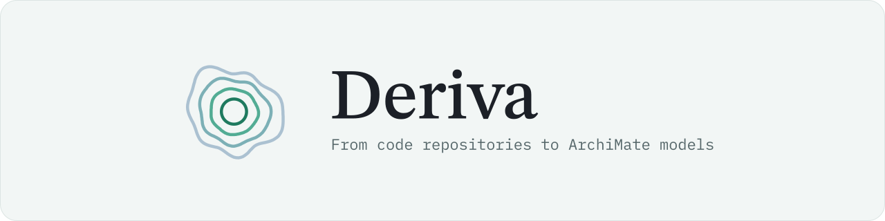
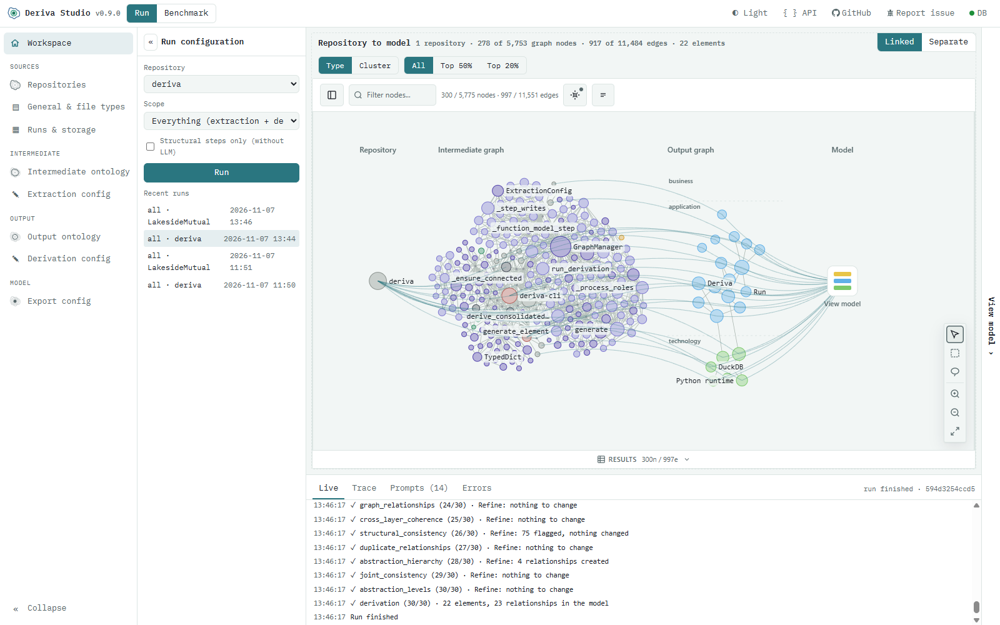

[](#)
[](https://github.com/StevenBtw/Deriva/actions/workflows/ci.yml)
[](https://www.python.org/downloads/)
[](https://github.com/StevenBtw/grafeo)
[](LICENSE) 

<picture>
  <source media="(prefers-color-scheme: dark)" srcset="assets/brand/deriva-banner-dark.svg">
  
</picture>

Deriva reads a software repository, builds a graph of what is in it, and derives an [ArchiMate](https://www.opengroup.org/archimate-forum) enterprise architecture model you can open in tools like [Archi](https://www.archimatetool.com/).

<picture>
  <source media="(prefers-color-scheme: dark)" srcset="assets/studio-dark.png">
  
</picture>

## How It Works

Deriva brings determinism to AI-assisted architecture model derivation. From repository to intermediate graph to output graph to the final ArchiMate model. Parsing and graph algorithms find the structure; an LLM reads what needs reading. Every prompt is versioned configuration you can open and change.

1. **Repository** (clone): the code as it is, a Git repository cloned locally. Deriva classifies every file by type, from source and config to docs, tests and build files.
2. **Intermediate graph** (extract): parsing (tree-sitter for most languages) turns the code into a graph of directories, files, types, methods, dependencies, technologies and business concepts. Graph metrics (PageRank, Louvain communities, k-core) then rank what matters.
3. **Output graph** (derive): graph structure picks the candidates and names them; an LLM makes the closed choices structure cannot (a directory's role, which documented concepts and actors count, how components group into applications), each from a fixed list, within ArchiMate's rules; then refine steps tidy the result. The studio shows both graphs side by side.
4. **ArchiMate model** (export): the output graph exports in the Open Group ArchiMate exchange format, ready to open in Archi.

## Install

```bash
uv tool install --python 3.14 deriva-studio
```

Then run `deriva`: the studio opens in your browser. Deriva runs on your own machine; you bring the LLM, a cloud API key or a local model.

## Documentation

Everything else is on **[docs.deriva.dev](https://docs.deriva.dev/)**:

- [Get started](https://docs.deriva.dev/get-started/): install, connect an LLM, derive your first model
- [Studio](https://docs.deriva.dev/studio/), [CLI](https://docs.deriva.dev/cli/), [Configuration](https://docs.deriva.dev/configuration/), [Data and queries](https://docs.deriva.dev/data/) and [Troubleshooting](https://docs.deriva.dev/troubleshooting/)
- [ArchiMate](https://docs.deriva.dev/archimate/) and [Architecture](https://docs.deriva.dev/architecture/): what Deriva derives and how it is put together
- [Benchmarking](https://docs.deriva.dev/benchmarks/) and [Optimization](https://docs.deriva.dev/optimization/): measure and improve the model
- [Changelog](https://docs.deriva.dev/changelog/): what changed in each release

The pages are built from [`docs/`](docs/) in this repository.

---

## Contributing

For development setup, architecture details, and contribution guidelines, see [CONTRIBUTING.md](CONTRIBUTING.md).

---

## License

This project is licensed under the **GNU Affero General Public License v3.0 or later (AGPL-3.0-or-later)**.

This means you can freely use, modify, and distribute this software, but if you run a modified version as a network service, you must make the source code available to users of that service.

See [LICENSE](LICENSE) for the full license text.

The bundled business function model is an excerpt of APQC's Process Classification Framework® (PCF), used under APQC's license; see [THIRD_PARTY_NOTICES.md](THIRD_PARTY_NOTICES.md).

## Acknowledgments

- [FastAPI](https://fastapi.tiangolo.com) and [React](https://react.dev) - The studio
- [anywidget-graph](https://github.com/GrafeoDB/anywidget-graph) and [anywidget-archimate](https://github.com/StevenBtw/anywidget-archimate) - Graph and model views
- [Grafeo](https://github.com/GrafeoDB/grafeo) - Embedded graph database
- [ArchiMate](https://www.opengroup.org/archimate-forum) - Enterprise architecture standard
- [Archi](https://www.archimatetool.com) - Open source ArchiMate modeling tool
- [Tree-sitter](https://tree-sitter.github.io/tree-sitter/) - Multi-language AST parsing

---

**Status**: Active Development
