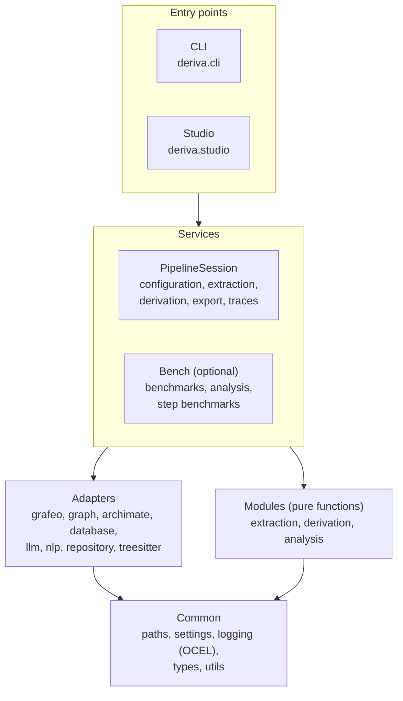

# Architecture

Deriva reads a repository into a graph, derives an ArchiMate model from that graph and exports it. This page shows how the code is organized: the pipeline, the abstraction levels of the model, the three packages, the layers and the rules between them, and where Deriva keeps its data.

## The pipeline

```text
Repository --> Extraction --> Graph --> Derivation --> ArchiMate model --> Export
```

```text
1. Clone      The repository is cloned into the workspace.

2. Extract    Graph namespace
              Repository -> Directory -> File -> TypeDefinition -> Method
              plus deployable units, build modules, deployments,
              Technology, ExternalDependency, Test and BusinessConcept

3. Derive     prep:          graph algorithms (PageRank, Louvain, k-core, ...)
              generate:      ArchiMate elements, one step per type
              relationship:  one pass over all elements
              refine:        duplicates, orphans, structural checks,
                             the component hierarchy and lifted relationships,
                             the joint selection, then the level tags
              Result: the Model namespace

4. Export     Open Exchange XML with a level on every element, relationship
              and view, which Archi and other tools import
```

Most extraction is deterministic: directories and files come from the file system, type definitions and methods from parsing the code with tree-sitter (Python, JavaScript, Java and C#) or with structural parsers (COBOL programs and copybooks, JCL jobs and BMS screen maps), dependencies and tests from parsers. LLM steps classify within closed sets, for example which documented terms are business concepts. Derivation picks its candidates from the graph with queries and graph properties, and asks the LLM to classify and name them.

## Abstraction levels

One model holds two abstraction levels, and the export adds a third. Every element and relationship carries the levels it belongs to, so each level is a filter on the same model, and an element that belongs to both levels exists once with one identifier.

| Level | Holds |
| --- | --- |
| Enterprise | The business layer, application and technology services, the top-level components, the platform node of each environment |
| Solution | Deployable units, build modules and libraries, interfaces, data objects, system software, one node per deployed service |
| Detail | The members of those elements (endpoints, entities, programs, deployed artifacts); written only to the export |

Which element types sit on which level is a versioned table (the `abstraction_levels` step's params); components are placed by the hierarchy below.

### The component hierarchy

The `BuildModule` extraction step finds the folders with a build manifest and code of their own (manifests such as Maven's, npm's, uv's or Gradle's, from a versioned list), and a parent system where an aggregator manifest lists at least two of them. The hierarchy goes from systems to units to modules to libraries:

- a system holds the units and modules in its folders;
- the only deployable unit at a module's folder holds that module; several units there are the module's entry points, and the module holds them;
- a unit holds a module that only it builds, and a module holds the modules nested in it.

A component without a parent is top-level: on both levels when it is a unit or a module, on the enterprise level when it is a system. Every other component is on the solution level, and the top-level component realizes the services of the components below it, so the enterprise level stands on its own. Each environment's node composes one node per deployment it runs.

### Relationships between the levels

A relationship is on the levels both its ends share; with none shared it is a cross-level link, such as the Composition from a top-level component to a component below it. A Serving, Access, Flow or Triggering relationship below the enterprise level also implies one between the nearest enterprise elements above its ends, and an Access to a data object reaches the business object it realizes. These lifted relationships are on the enterprise level only, and each lists the relationships it comes from.

The hierarchy's relationships and the lifted ones are proposals like any other: the `abstraction_hierarchy` step makes them just before the joint selection (`joint_consistency`), which decides on all relationships together. After the selection only the level tags are written; a step there that adds or removes an element or relationship is reported as an error of the run.

### Views per level

The export has the enterprise views (Layered, Application Cooperation, Information Structure, Implementation and Deployment, Business), the solution views (Application Structure, Application Cooperation, Information Structure, Implementation and Deployment) and three detail views (Information Structure, Implementation and Deployment, and the application interfaces with their members). A view shows the elements and relationships of its level; cross-level links are in no view.

## Packages

Deriva is built as three Python packages in one repository (a uv workspace). All three share the Python namespace `deriva`; the namespace has no `__init__.py`, so each package adds its own subpackages to it.

| Package | Contains | Commands |
| --- | --- | --- |
| `deriva-cli` | The pipeline and the command line: `deriva.adapters`, `deriva.modules`, `deriva.common`, `deriva.services`, `deriva.cli` | `deriva-cli` |
| `deriva-studio` | Deriva Studio, `deriva.studio`: a FastAPI app with the built React front end | `deriva`, `deriva-studio`, `deriva-cli` |
| `deriva-dev` | Benchmarking, `deriva.bench` | `deriva`, `deriva-dev`, `deriva-cli` |

`deriva-studio` depends on `deriva-cli` and `deriva-dev` on `deriva-studio`, so each package includes the ones before it. All three share one version number. In the repository, the studio lives in `packages/deriva-studio/` (its front end source in `studio/`, built with `npm run build`), and benchmarking in `packages/deriva-dev/`.

## Layers



### Entry points

The command line (`deriva.cli`) and the studio (`deriva.studio`) talk to the pipeline only through the services layer: `PipelineSession` for the pipeline itself, and a few service modules for helpers such as the run call logs (`deriva.services.llm_log`). The studio is a local web app (`deriva` starts it): a FastAPI backend that serves the pipeline, both graphs, the model and the configuration, with live run progress, and a React front end.

### Services

The services layer is the API of Deriva. `PipelineSession` opens and closes the connections, runs extraction, derivation and export, and manages configurations and their versions. Services load each step's configuration and pass the text to the modules, so every LLM call has a versioned configuration behind it.

### Bench

Benchmarking (`deriva.bench`, in `deriva-dev`) sits at the services level: benchmark runs, step benchmarks, analysis, the benchmark views and configuration deviations. `BenchmarkSession` wraps a `PipelineSession`. The package also holds one command module (`deriva.bench.cli`) and one studio router (`deriva.bench.router`). The CLI and the studio load these only when the package is installed, which `deriva.services.about.features()` checks; the studio reports it in `/api/status` under `features`.

### Adapters

Adapters connect Deriva to the outside world:

| Adapter | Purpose |
| --- | --- |
| `grafeo` | The embedded graph database |
| `graph` | The extracted graph, in the Graph namespace |
| `archimate` | The ArchiMate model in the Model namespace, the ArchiMate metamodel and the XML export |
| `database` | DuckDB for configurations, their versions and settings |
| `llm` | One interface to several LLM providers, with caching, rate limiting and retries |
| `nlp` | Candidate terms from documentation: pinned spaCy pipelines (English, German, French) and pinned translation models |
| `repository` | Git and file system access |
| `treesitter` | Parsing source code in several languages |

The `nlp` adapter downloads its language models on first use into the workspace cache and verifies them by SHA-256. spaCy and the translation library load on the first extraction, not on import, and the adapter reports their versions, which are recorded with each run.

### Modules

Modules hold the logic of each stage as pure functions: `extraction` (one module per node type), `derivation` (prep, one module per element type, refine steps) and `analysis` (consistency, stability and model quality). A module never calls an LLM provider itself; it calls the query function it is given.

### Common

Shared code with no dependencies on the other layers: the home folder (`paths`), the settings (`settings`), OCEL event logging, types, exceptions and utilities for files, JSON, time, chunking and document reading.

## Layer rules

| Layer | May import | May not import |
| --- | --- | --- |
| CLI, studio | services | adapters, modules, common |
| Services | adapters, modules, common | cli, studio |
| Adapters | common | modules, services, cli, studio |
| Modules | common | adapters, services, cli, studio |
| Common | the standard library and third-party packages | any other Deriva layer |

Nothing imports `deriva.bench` except the CLI's and the studio's entry points, behind the feature check. Within `deriva.bench`, only its command module may import the CLI and only its router may import the studio.

### How the rules are enforced

Each layer has a `ruff.toml` that extends the project configuration and bans the imports the layer may not make, using ruff's `flake8-tidy-imports` rule. A violation fails `ruff check`:

```toml
# deriva/modules/ruff.toml (messages shortened)
extend = "../../pyproject.toml"

[lint.flake8-tidy-imports.banned-api]
"deriva.cli" = { msg = "cli is a top-level entry point" }
"deriva.bench" = { msg = "only the entry points load deriva.bench" }
"deriva.adapters" = { msg = "modules cannot import from adapters" }
"deriva.services" = { msg = "modules cannot import from services" }
```

The project configuration bans `deriva.cli` and `deriva.bench` everywhere. A layer's ban table replaces the project's, so each layer file repeats those two bans where they apply. The services layer has no file of its own; the project's bans apply there.

### Known exception

The derivation and extraction modules still import some manager and model types from the adapters (ArchiMate, graph, LLM, tree-sitter). These imports are marked `# noqa: TID251`, so any new violation still fails `ruff check`. Removing them means passing those types in from the services layer.

## Where data lives

Deriva keeps everything in one home folder: `DERIVA_HOME` when it is set, the repository root when Deriva runs from a source checkout, and `~/.deriva` otherwise.

| Store | Holds | Where |
| --- | --- | --- |
| `.env` | Settings and LLM model configurations | The home folder |
| DuckDB (`sql.db`) | Step configurations with their versions, file types, name patterns, system settings | The home folder; in a source checkout `deriva/adapters/database/sql.db` |
| Grafeo | The extracted graph (Graph namespace) and the ArchiMate model (Model namespace) | In memory, or one `.grafeo` file per repository in `GRAFEO_DB_DIR` |
| Workspace | Cloned repositories, graphs, caches, runs, benchmark sessions, logs, exports | `workspace/` in the home folder |

The graph and the model share one embedded database and are kept apart by namespace labels (`Graph`, `Model`).

### Settings

`deriva.common.settings` is the only code that reads configuration from the environment. It merges the home folder's `.env` with the process environment, and the process environment wins. Settings come in typed groups by prefix: `LLM_`, `GRAFEO_`, `GRAPH_`, `ARCHIMATE_`, `DERIVA_NLP_` and `REPOSITORY_`. Only the LLM providers' own keys (such as `OPENAI_API_KEY`, `ANTHROPIC_API_KEY` and `MISTRAL_API_KEY`) are passed on to the process environment for the provider libraries, and never over a variable that is already set.

## Design decisions

1. **Services are the API.** The CLI and the studio go through the services layer only (mostly `PipelineSession`), so both behave the same and a change has one place to go.
2. **Structure decides, the LLM classifies.** Candidates, identifiers and many relationships come from the graph. The LLM chooses within closed sets, so runs stay comparable and differences can be traced to a single answer.
3. **Prompts are configuration.** Every text that steers the LLM is a versioned configuration row; the code only adds structure. A run is fully described by its configuration versions.
4. **Versioned configuration.** A change creates a new version and keeps the old ones, so results can be compared and changes undone.
5. **Graph algorithms guide derivation.** PageRank, Louvain communities and k-core levels decide which nodes are worth considering, before any LLM call.
6. **Parsing over LLMs where possible.** Tree-sitter extracts types and methods in several languages deterministically and without LLM cost.
7. **One embedded database.** Grafeo runs inside the process, so Deriva needs no database server, and namespaces keep the graph and the model apart.
8. **Levels from structure.** The levels, the component hierarchy and the lifted relationships come from build manifests, folders and the graph, never from an LLM, so every level is as consistent as the structure it comes from.
